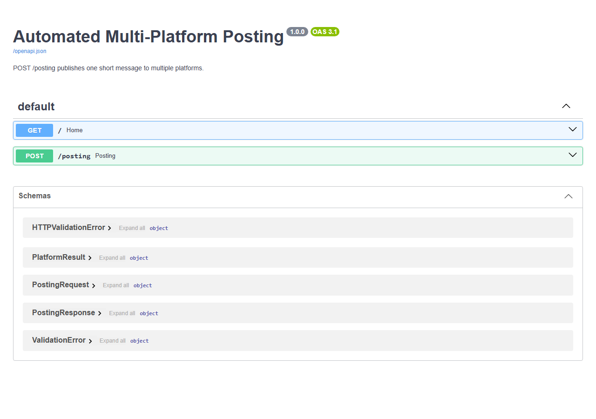

# Automated multi-platform posting

FastAPI app for the Python practical test.

`POST /posting` takes one message, validates it, then publishes it on 9 platforms. The client does not pick platforms. If one API fails, the others still run.

## Platforms

| Platform | Docs | Auth | Public? |
|---|---|---|---|
| Telegram | https://core.telegram.org/bots/api#sendmessage | bot token + chat id | yes if channel username is set |
| Discord | https://discord.com/developers/docs/resources/webhook#execute-webhook | webhook url | no |
| Slack | https://api.slack.com/messaging/webhooks | webhook url | no |
| Mastodon | https://docs.joinmastodon.org/methods/statuses/ | access token | yes |
| GitHub Gist | https://docs.github.com/en/rest/gists/gists#create-a-gist | token (`gist` scope) | yes |
| Bluesky | https://docs.bsky.app/docs/api/com-atproto-repo-create-record | handle + app password | yes |
| Hugging Face | https://huggingface.co/docs/huggingface_hub/guides/community | token + repo id | yes (LLM hub discussion) |
| Dev.to | https://developers.forem.com/api/v1#tag/articles/operation/createArticle | api key | yes |
| dpaste | https://dpaste.com/api/v2/ | none | yes |

dpaste does not need a key, so a local run still produces at least one real public URL.

## Project Structure

```text
automated-posting/
├── app/
│   ├── main.py                  # FastAPI app & custom error handler
│   ├── schemas.py               # Request/Response models & validators
│   ├── config.py                # Environment configuration (Pydantic Settings)
│   ├── platforms/               # Platform implementations
│   │   ├── base.py              # BasePlatform abstract class & error mapping
│   │   ├── bluesky.py
│   │   ├── devto.py
│   │   ├── discord.py
│   │   ├── dpaste.py
│   │   ├── github_gist.py
│   │   ├── huggingface.py       # LLM platform integration
│   │   ├── mastodon.py
│   │   ├── slack.py
│   │   └── telegram.py
│   └── services/
│       └── posting_service.py   # Asynchronous multi-platform orchestrator
├── logs/
│   └── posting.log              # JSON lines execution logs
├── screenshots/
│   └── swagger.png              # Swagger UI documentation capture
├── tests/
│   ├── test_platforms.py        # Isolated platform tests with mocked HTTP
│   ├── test_posting.py          # Service orchestration & failure handling
│   └── test_validation.py       # Pydantic & HTTP 400 validation tests
├── .env.example
├── pytest.ini
├── requirements.txt
└── README.md
```

## Setup

```bash
python -m venv .venv
.venv\Scripts\activate
pip install -r requirements.txt
copy .env.example .env
```

Fill `.env` for the platforms you want. Empty values come back as `failed` with a missing-credentials error.

## Run

```bash
uvicorn app.main:app --host 0.0.0.0 --port 4000
```

Swagger UI: http://localhost:4000/docs

## Request

```bash
curl -X POST http://localhost:4000/posting -H "Content-Type: application/json" -d "{\"message\": \"Check out our latest business platform and grow your online visibility. https://example.com\"}"
```

```json
{
  "message": "Check out our latest business platform and grow your online visibility. https://example.com"
}
```

## Validation

- max 200 characters
- exactly one `http`/`https` CTA link
- that link must be a valid URL
- empty / missing `message` is rejected

Invalid input returns HTTP 400:

```json
{
  "success": false,
  "error": "Exactly one CTA link must be included in the message.",
  "results": []
}
```

## Success response

```json
{
  "success": true,
  "results": [
    {
      "platform": "dpaste",
      "status": "success",
      "posted_url": "https://dpaste.com/ABC123",
      "public_access": true,
      "date": "2026-11-16",
      "time": "12:05:01",
      "error": null
    },
    {
      "platform": "Slack",
      "status": "failed",
      "posted_url": null,
      "public_access": false,
      "date": null,
      "time": null,
      "error": "Missing credentials: SLACK_WEBHOOK_URL"
    }
  ]
}
```

`success` is true if at least one platform posted.

Sample run: `sample_output.json`  
Request log: `logs/posting.log`  

### Swagger UI Screenshot



## Keys

- Telegram: @BotFather token, chat id, optional public channel username
- Discord: channel webhook
- Slack: incoming webhook
- Mastodon: app access token with `write:statuses`
- GitHub: PAT with `gist`
- Bluesky: handle + app password
- Hugging Face: write token + `HF_REPO_ID` like `username/repo`
- Dev.to: Settings → Extensions → API key

## Tests

```bash
pytest -q
```

Tests cover validation cases, independent failures, auth/timeout mapping, and each platform's request/response with mocked HTTP.
